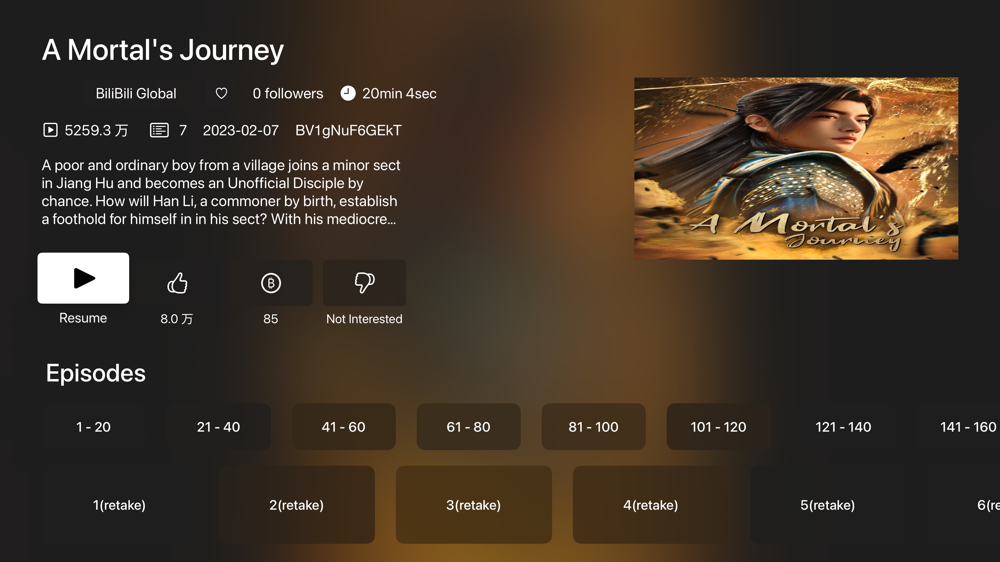

# Bilibili Global for Apple TV

An English-first, unofficial tvOS client for [Bilibili Global](https://www.bilibili.com/en).

This project is not affiliated with Bilibili and is not distributed through the App Store or TestFlight. Do not pay third parties for builds of this app.

### Features

- QR-code sign-in
- Live streams and danmaku
- Personalized recommendations, trending videos, rankings, search, following, favorites, history, and Watch Later
- System-player video playback with HDR, subtitles, and danmaku controls
- Account switching and TV casting

The app uses Bilibili's existing web endpoints with the Global (`/en`) web context. Availability is determined by Bilibili for the viewer's account and region; the app does not provide regional-content bypassing.

 
 
 

### Telegram Group
 - https://t.me/appletvbilibilidemo

### Unsigned IPA

Download nightly builds from https://github.com/yichengchen/ATV-Bilibili-demo/releases/tag/nightly.

### Links

- App Icon [【22娘×33娘】亲爱的UP主，你怎么还在咕咕咕？](https://www.bilibili.com/video/BV1AB4y1k7em)

- [thmatuza/MPEGDASHAVPlayerDemo](https://github.com/thmatuza/MPEGDASHAVPlayerDemo)

- [dreamCodeMan/B-webmask](https://github.com/dreamCodeMan/B-webmask)

- [分析Bilibili客户端的“哔哩必连”协议](https://xfangfang.github.io/028)
