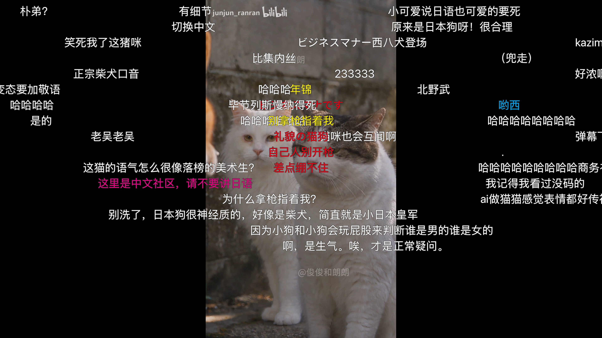
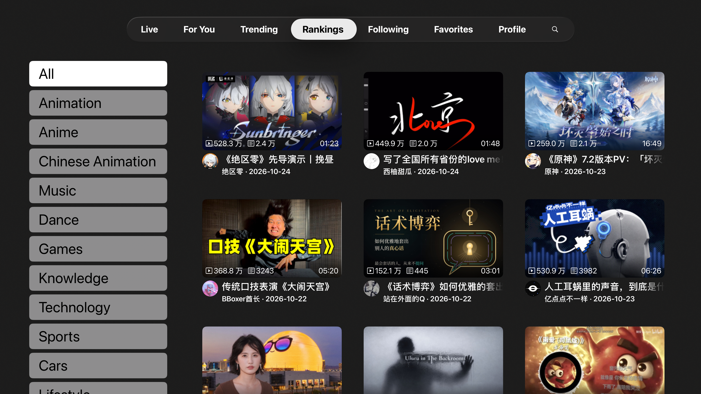

# Bilibili Global for Apple TV

This project is a fork of [yichengchen/ATV-Bilibili-demo](https://github.com/yichengchen/ATV-Bilibili-demo).

An English-first, unofficial tvOS client for [Bilibili Global](https://www.bilibili.com/en).

This project is not affiliated with Bilibili and is not distributed through the App Store or TestFlight. Do not pay third parties for builds of this app.

### Features

- QR-code sign-in
- Live streams and danmaku
- Personalized recommendations, trending videos, rankings, search, following, favorites, history, and Watch Later
- System-player video playback with HDR, subtitles, and danmaku controls
- Account switching and TV casting

The app uses Bilibili's existing web endpoints with the Global (`/en`) web context. Availability is determined by Bilibili for the viewer's account and region; the app does not provide regional-content bypassing.

 
 
 

### Builds and installation

Nightly, unsigned IPAs are available from https://github.com/ArcticFox01/ATV-BilibiliGlobal-demo/releases/tag/nightly. An unsigned IPA **cannot be installed on a normal Apple TV** by itself; a GitHub Actions build is an artifact, not a public distribution method.

To run the app on your own Apple TV, open `BiliBiliGlobal.xcodeproj` in Xcode, select the app target, choose your own signing team under **Signing & Capabilities**, then select your connected Apple TV and run the app. Xcode creates a development provisioning profile that is valid only for devices registered to that team.

Do not use this repository to share certificates, private keys, provisioning profiles, or App Store Connect keys. Keep signing assets in your Keychain and, if needed for CI, in encrypted GitHub Actions secrets.

For distributing the app beyond your own registered devices, use one of Apple's supported paths:

- **Ad Hoc distribution**: register each recipient's Apple TV UDID in a paid Apple Developer account and build an IPA with an Ad Hoc profile.
- **TestFlight**: distribute beta builds to invited testers after App Store Connect processing.
- **App Store**: submit a release for public availability.

### Links

- App Icon [【22娘×33娘】亲爱的UP主，你怎么还在咕咕咕？](https://www.bilibili.com/video/BV1AB4y1k7em)

- [thmatuza/MPEGDASHAVPlayerDemo](https://github.com/thmatuza/MPEGDASHAVPlayerDemo)

- [dreamCodeMan/B-webmask](https://github.com/dreamCodeMan/B-webmask)

- [分析Bilibili客户端的“哔哩必连”协议](https://xfangfang.github.io/028)
